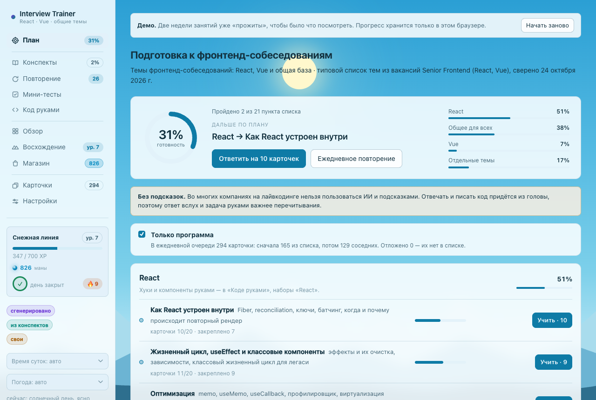
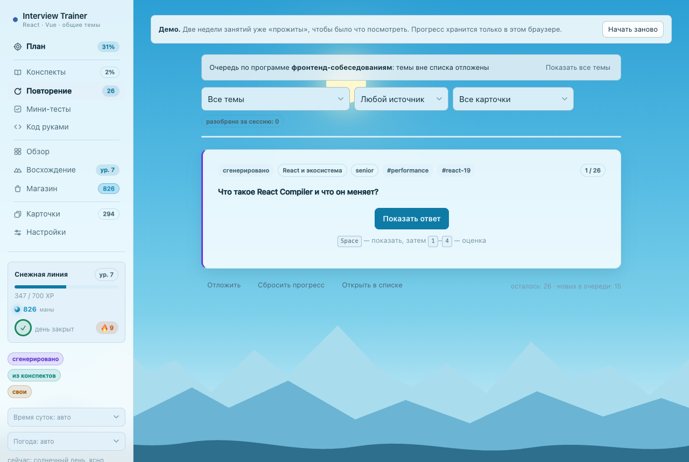
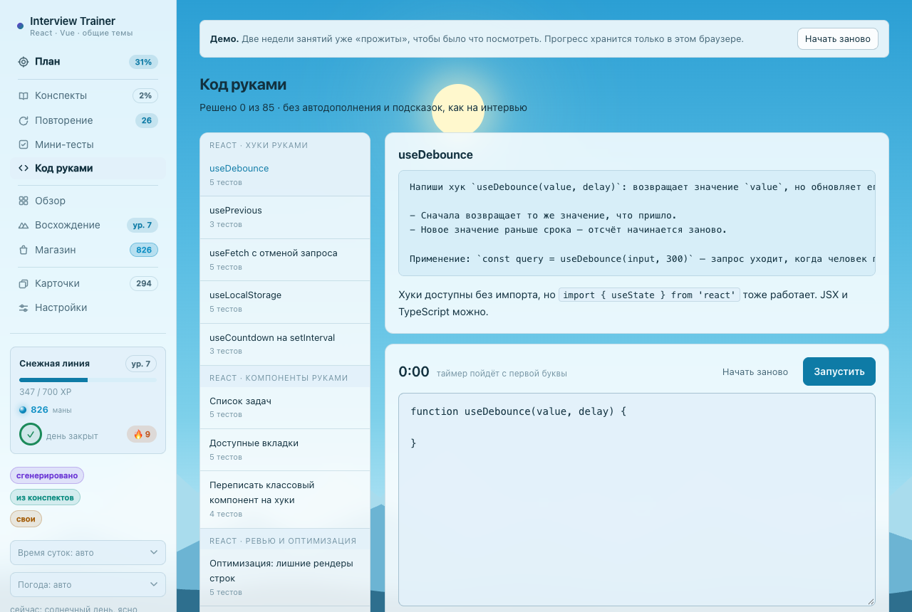
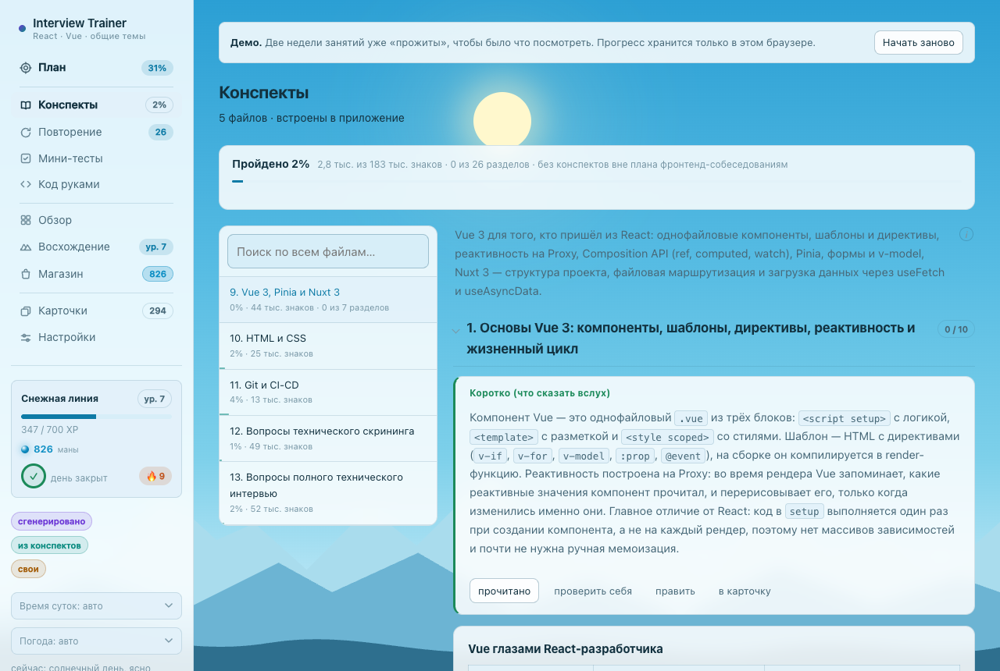
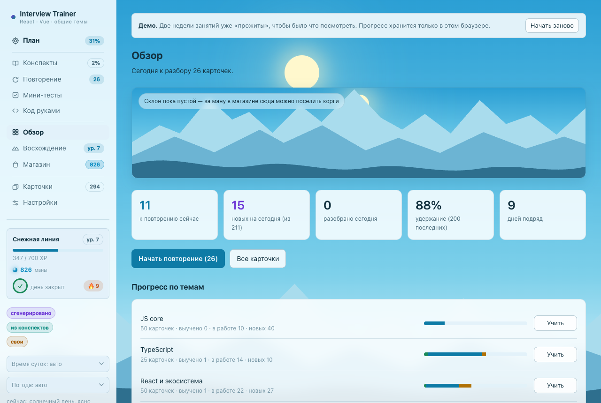
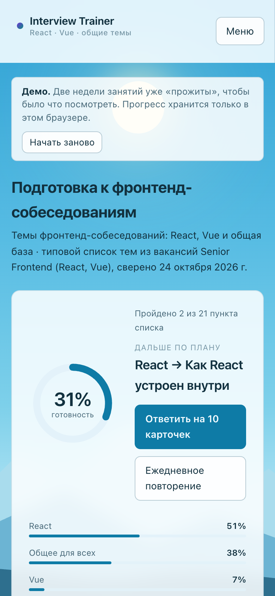

# Interview Trainer

Приложение для подготовки к техническим собеседованиям по фронтенду: интервальное повторение
карточек, конспекты с самопроверкой, мини-тесты и тренажёр кода, где решения на React, Vue и
JavaScript проверяются автотестами прямо в браузере.

Сделала для себя, пока готовилась к собеседованиям на Senior Frontend. Разрабатывала с помощью
ИИ-агентов (Claude Code); как именно — в разделе [«Разработка с ИИ-агентами»](#разработка-с-ии-агентами).

**Демо:** _ссылка появится после публикации_ — работает без регистрации, прогресс хранится только
в вашем браузере. Две недели занятий в демо уже «прожиты», чтобы сразу было что посмотреть.



## Что можно посмотреть за две минуты

1. **План** — темы из вакансий по блокам (React, общая база, Vue, отдельные темы), готовность по
   каждой и пробелы там, где материала пока нет.
2. **Повторение** — карточка → `Space` → ответ → оценка `1`–`4`. На кнопках видно, когда карточка
   вернётся: интервалы считает алгоритм SM-2.
3. **Код руками** — 85 задач в 19 наборах: хуки и компоненты на React, composables и Pinia,
   асинхронность и алгоритмы на JS, задачи «что выведет код». Решение запускается в Web Worker
   с автотестами и ограничением по времени.
4. **Конспекты** — Markdown-файлы, разбитые на разделы: чтение карточками, поиск, правка на месте,
   «проверить себя» по каждой карточке.
5. **Обзор** и **Восхождение** — статистика, тепловая карта занятий, серия дней, опыт и достижения.

| Повторение | Тренажёр кода |
|---|---|
|  |  |
| **Конспекты** | **Обзор** |
|  |  |



## Стек

- **Клиент:** React 19, TypeScript (strict), React Router 7, Vite 6. Состояние — хуки и загрузка
  данных на уровне приложения, без отдельного стейт-менеджера. Своя вёрстка без UI-библиотеки:
  темы на CSS-переменных, адаптив до 375px.
- **Сервер:** Node.js и Express 4, около 34 REST-маршрутов. База — JSON-файл с атомарной записью
  и снимком при каждом запуске.
- **Песочница для кода:** Web Worker; внутри Vue 3 и Pinia, для React — окружение, собранное
  esbuild из react-test-renderer и sucrase.
- **Markdown:** marked и highlight.js.

## Архитектура

- Маршруты API описаны **без привязки к транспорту** ([server/api.mjs](server/api.mjs),
  [shared/router.js](shared/router.js)). Локально их подключает Express, а в демо-сборке тот же
  код выполняется прямо в браузере: `node:fs`, `node:path` и `node:url` подменены на свои
  реализации ([src/demo](src/demo)), файловая система — в памяти, прогресс — в IndexedDB.
  Поэтому у демо нет сервера, общей базы и поверхности для злоупотреблений.
- Алгоритм интервального повторения — один модуль ([shared/srs.js](shared/srs.js)) для сервера
  и клиента.
- Контент — данные, а не код: программа подготовки, тесты и вопросы самопроверки лежат в JSON,
  конспекты — в Markdown. Программа связывает темы с карточками, разделами и тестами.
- Обычная и демо-сборка расходятся только точкой входа ([src/main.tsx](src/main.tsx) и
  [src/main.demo.tsx](src/main.demo.tsx)): в обычную сборку демо-код не попадает.

## Что было сложным

- **Тесты React-кода в браузере, без сервера и без Node.** Решение пользователя компилируется
  sucrase (JSX и TypeScript) и рендерится react-test-renderer внутри Web Worker. Поверх —
  свои помощники в духе Testing Library (`render`, `click`, `type`, `byRole`), предупреждения
  React показываются пользователю. Пришлось отдельно разбираться с `act`: он склеивал все
  обновления внутри ожидания, и таймеры в тестах не тикали.
- **Один серверный код для двух сред.** Чтобы демо работало как статический сайт, маршруты
  отвязаны от Express, а синхронные вызовы `fs` обслуживает файловая система в памяти.
  Заготовленный прогресс для первого визита создаётся теми же маршрутами со сдвинутыми часами:
  интервалы, серия и достижения посчитаны самим приложением, а не нарисованы.
- **Приватный контент.** Часть конспектов — рабочие материалы, публиковать их нельзя. Правило
  одно ([shared/private-content.js](shared/private-content.js)) для `.gitignore` и демо-сборки,
  а [scripts/check-demo.mjs](scripts/check-demo.mjs) после сборки сверяет её с отпечатками
  приватных файлов и роняет сборку при совпадении.
- **Экономика игрового слоя.** Повторение даёт больше опыта, чем новая карточка, а за честное
  «не помню» опыт не урезается — иначе выгодно врать себе, и вся статистика теряет смысл.

## Запуск локально

Нужен Node.js 20 или новее.

```bash
npm install
npm run dev        # клиент на :5173, API на :5174
```

Демо-версия, как на хостинге:

```bash
npm run dev:demo       # с горячей перезагрузкой, :5373
npm run build:demo     # сборка в dist-demo и проверка на приватный контент
```

Проверить все задачи тренажёра (эталоны проходят тесты, заготовки — нет):

```bash
node --experimental-strip-types scripts/verify-tasks.mjs
```

## Разработка с ИИ-агентами

Приложение написано с помощью Claude Code. Внутри самого приложения ИИ нет.

Как я контролировала результат:

- **Ограничения на правки.** Агенту нельзя менять смысл и формулировки моих конспектов — только
  оформление. Правки идут на отдельном экземпляре приложения с тестовой базой, настоящая база
  не трогается.
- **Проверка силами агента.** Агент прогоняет автоматические проверки и смотрит изменения в
  запущенном приложении, включая ширину телефона.
  [scripts/verify-tasks.mjs](scripts/verify-tasks.mjs) проверяет эталонное решение, заготовку и
  ответ каждой из 85 задач. [scripts/check-demo.mjs](scripts/check-demo.mjs) ловит утечку
  приватного контента в демо-сборку.
- **Ручная проверка.** Новые функции я проверяла сама, руками в браузере, как пользователь: по
  этому приложению я и готовилась к собеседованиям.
- **Решения по продукту — мои:** что учить, как устроен план, какие правила у игрового слоя.

## Данные

- Карточки в `data/seed`, конспекты в `data/notes`, тесты в `data/quiz`, программа в
  `data/program/demo.json`.
- Личный прогресс (`data/db.json`), его копии и рабочие материалы в репозиторий не попадают.

## Лицензия

- Код — [MIT](LICENSE).
- Учебный контент (конспекты, карточки, тесты, задачи тренажёра, скриншоты) —
  [CC BY-NC 4.0](LICENSE-CONTENT.md): можно использовать и переделывать с указанием автора,
  но не в коммерческих целях.
